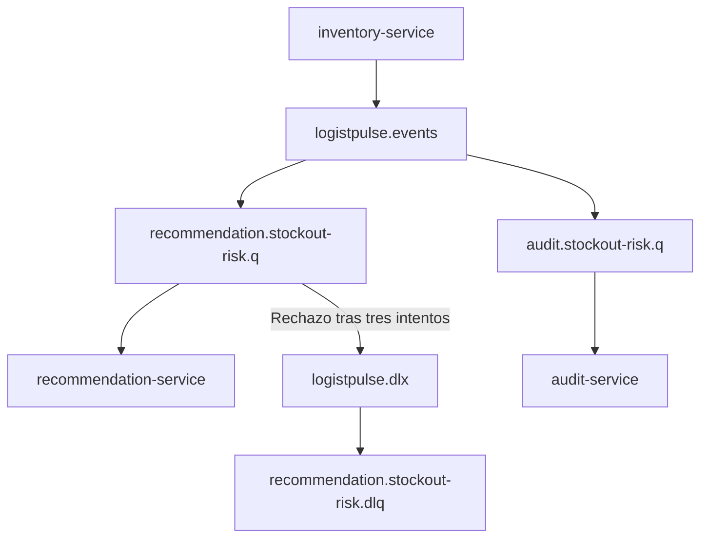

# LOGISTPULSE — Resiliencia y evolución EDA

**Pablo Galarza — Desarrollo de Software Moderno, USFQ**

Implementación y comprobación de cuatro casos de arquitectura dirigida por eventos con Java 21, Spring Boot y RabbitMQ.

## Entrega

- [Informe: resultados, respuestas y conclusión](laboratorio-eda/INFORME.md)
- [Código y guía del laboratorio](laboratorio-eda/)
- [Evidencias de ejecución](laboratorio-eda/evidencias/)

La implementación de esta entrega está en `laboratorio-eda/`. Su archivo de ejecución es `laboratorio-eda/docker-compose.yml`.

## Ejecutar

Requisitos: Docker con Docker Compose v2 y Python 3 para generar los datos de la prueba de duplicados.

Desde la raíz del repositorio:

```bash
cd laboratorio-eda
docker compose up --build -d
docker compose ps
```

Docker compila las aplicaciones con Java y Maven dentro de las imágenes.

Para observar el arranque:

```bash
docker compose logs -f inventory-service recommendation-service audit-service
```

Espera las líneas de inicio `Started`. Sal de los logs con `Ctrl + C`; los servicios continuarán ejecutándose.

## Servicios y puertos

| Servicio | Puerto accesible | Función |
|---|---|---|
| inventory-service | 8080 | Recibir lecturas de inventario y publicar eventos de riesgo |
| recommendation-service | 8081 | Procesar eventos y consultar recomendaciones |
| audit-service | Sin puerto HTTP publicado | Registrar los eventos recibidos |
| RabbitMQ | 5672 | Comunicación AMQP |
| Consola de RabbitMQ | 15672 | Inspeccionar exchanges y colas |

Credenciales de RabbitMQ para este laboratorio: usuario `lab`, contraseña `lab123`.

## APIs

| Puerto | Método | Ruta |
|---|---|---|
| 8080 | POST | `/api/inventory/stock` |
| 8081 | GET | `/api/recommendations/health` |
| 8081 | GET | `/api/recommendations` |
| 8081 | GET | `/api/recommendations?eventId=IDENTIFICADOR` |

Comprobar la API desde la terminal del Codespace:

```bash
curl -fsS http://localhost:8081/api/recommendations/health
```

Cuando `available <= minimum`, inventario publica un evento y devuelve su `eventId`. El procesamiento de los consumidores es asíncrono.

## Arquitectura



- Routing key de publicación: `inventory.stockout-risk.detected`.
- Routing key hacia la DLQ: `recommendation.stockout-risk.failed`.
- Recomendaciones y auditoría utilizan colas independientes.
- Recomendaciones realiza hasta tres intentos, con una pausa fija de un segundo entre intentos.

## Casos comprobados

| Caso | Resultado | Evidencias |
|---|---|---|
| Consumidor detenido | Diez eventos acumulados y procesados tras reanudarlo | [Caso 1](laboratorio-eda/evidencias/caso-1/) |
| Dos consumidores | Un mismo evento recibido por recomendaciones y auditoría | [Caso 2](laboratorio-eda/evidencias/caso-2/) |
| Fallo controlado | Tres intentos, mensaje en DLQ y procesamiento posterior de un evento válido | [Caso 3](laboratorio-eda/evidencias/caso-3/) |
| Evento duplicado | Dos entregas, una recomendación y un duplicado ignorado | [Caso 4](laboratorio-eda/evidencias/caso-4/) |

El [informe](laboratorio-eda/INFORME.md) contiene la tabla detallada, las respuestas y las mejoras propuestas para un entorno real.

## Alcance de la idempotencia

Las recomendaciones se guardan en un `ConcurrentHashMap`, utilizando `eventId` como clave y `putIfAbsent` para registrar de forma atómica.

La protección corresponde a una instancia en ejecución. El registro se pierde al reiniciar la aplicación y no se comparte entre varias instancias.

El script `laboratorio-eda/scripts/preparar_duplicado.py` genera los archivos utilizados en la prueba del caso 4.

## Detener los servicios

Desde `laboratorio-eda`:

```bash
docker compose stop
```

## Procedencia

El código inicial de EDA procede de [randUSFQ/LABEDA](https://github.com/randUSFQ/LABEDA), archivo `rabbitmq-logistpulse-lab (4).zip`.

Este repositorio se creó como fork de [LOGISTPULSE-GOLDEN](https://github.com/randUSFQ/LOGISTPULSE-GOLDEN). Para esta entrega se utiliza exclusivamente el laboratorio ubicado en `laboratorio-eda/`.
